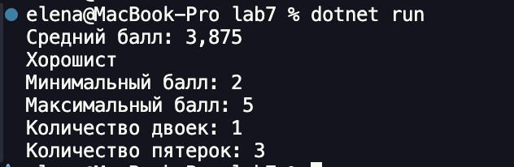
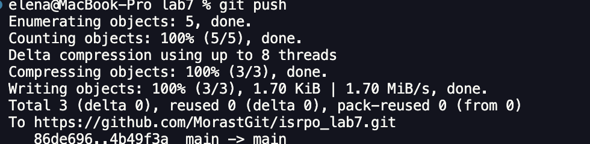

# Практическая работа №7
**ФИО: Козубенко Елена**  
**Группа: ИСП-241**  
**Дата: 10.10.2026**  
## Что изучено
1. for и foreach
    - foreach берет ТОЛЬКО значения без индексов
2. индексация в массивах начинается с нуля
3. работа с массивами, замена значений в массивах, доступ по индексу

